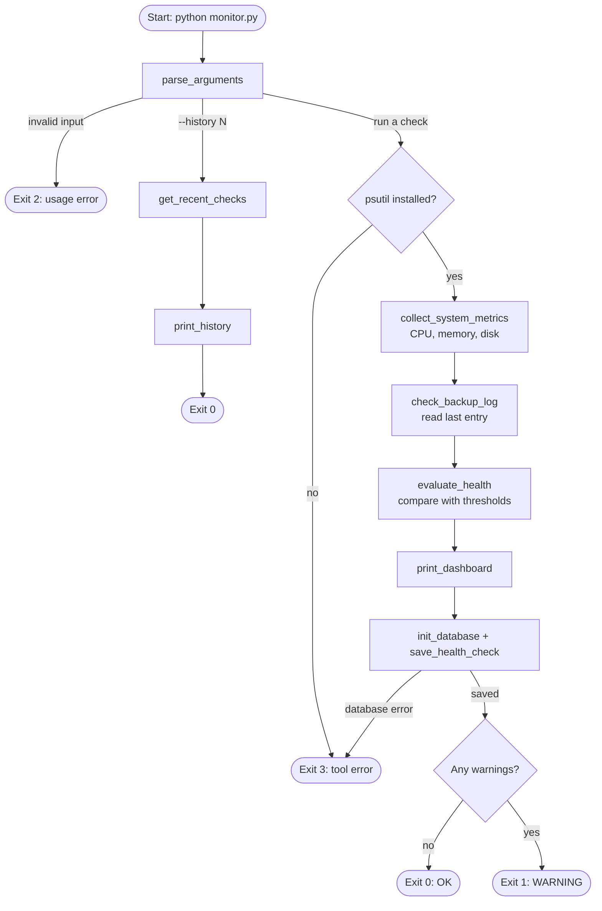

# Automated Server Health & Backup Log Monitor

[](https://github.com/Venil-Chand/server-health-monitor/actions/workflows/tests.yml)

A lightweight Python command-line tool that checks a server's CPU, memory and disk usage, verifies the result of the most recent backup from a log file, flags anything that needs attention, and keeps a history of every check in a local SQLite database.

It runs **one check and exits**, so it is designed to be scheduled with Windows Task Scheduler or Linux cron, the way routine checks are automated in a Managed Service Provider (MSP) environment.

> Educational portfolio project (Version 1.0.1). See [Limitations](#limitations) before relying on it for anything important.

---

## Project Overview

MSPs look after servers for many client businesses at once. Technicians cannot log in to every machine every day, so they depend on automated checks that answer two questions quickly:

1. **Is the server healthy right now?** (Is a disk filling up? Is memory exhausted?)
2. **Did last night's backup work?**

This tool answers both questions for the machine it runs on, prints a clear report, returns an exit code that other automation can act on, and records the result so trends can be reviewed later.

## Business Problem

- **Disk capacity.** When a disk fills up, databases stop writing, email servers reject mail, Windows updates fail and backups have nowhere to go. A disk usually fills gradually, so it is easy to prevent if someone notices early and very disruptive if nobody does.
- **Memory exhaustion.** Sustained high memory usage makes servers slow or unresponsive and can cause applications to crash, which shows up as lost staff time and support tickets.
- **Silent backup failures.** A backup job that has been failing for weeks is often discovered only when a file needs restoring, which is the worst possible time. For a small business, losing accounting data or client files can be serious.

## Solution

`monitor.py` automates the routine checks:

1. Collects CPU, memory and disk statistics with `psutil`.
2. Reads the last entry of `backup.log` and extracts its status field.
3. Compares the results with configurable thresholds and writes a plain-English warning for each problem.
4. Prints a terminal dashboard.
5. Saves the result to `system_health.db` so history can be reviewed with `--history`.
6. Exits with a code (`0` OK, `1` WARNING, `2` bad arguments, `3` tool error) that a scheduler or monitoring platform can use.

## Key Features

- CPU usage measured over a real sampling interval (default 1 second)
- Memory and disk usage, plus free memory and free disk space
- Configurable disk path with a sensible default (`C:\` on Windows, `/` on Linux)
- Backup log parsing that reads the status as a separate field, never as a loose substring
- Efficient log reading: the file is read backwards in small blocks, so large logs are not loaded into memory
- Clear handling of missing, empty, unreadable and malformed logs
- Configurable warning thresholds using a strict *greater-than* comparison
- Optional stale-backup detection (`--max-backup-age-hours`)
- A metric that cannot be collected produces a warning; the system is never reported healthy on missing data
- SQLite history with parameterised queries and automatic table creation
- Meaningful exit codes that separate "the server needs attention" from "the monitoring tool failed"
- 39 automated tests with mocked metrics and temporary files, run automatically on Windows and Linux with GitHub Actions

## Technologies Used

| Technology | Why it was chosen |
|---|---|
| **Python 3** | Widely used for automation and scripting in IT operations; runs on Windows and Linux without changes. |
| **psutil** | One cross-platform API for CPU, memory and disk statistics, instead of separate Windows and Linux commands. |
| **SQLite (`sqlite3`)** | Built into Python, needs no server, stores everything in a single file, and still supports real SQL. |
| **argparse** | Standard-library command-line parsing with built-in `--help` and input validation. |
| **pathlib / datetime / logging** | Standard-library tools for safe file paths, UTC timestamps and diagnostic messages. |
| **unittest / unittest.mock** | Built-in testing, so no extra test dependencies are needed. |

The only third-party dependency is `psutil`.

## System Architecture



Project layout:

```text
server-health-monitor/
├── monitor.py            # The application
├── backup.log            # Demonstration backup log
├── requirements.txt      # Third-party dependency (psutil)
├── README.md
├── .gitignore
├── LICENSE               # MIT licence
├── .github/workflows/
│   └── tests.yml         # Runs the tests on every push (GitHub Actions)
├── tests/
│   ├── __init__.py
│   └── test_monitor.py   # Automated tests
└── system_health.db      # Created automatically; not committed to Git
```

## Installation

Requires **Python 3.9 or newer**.

### Windows (PowerShell)

```powershell
# 1. Go to the project folder
cd C:\Projects\server-health-monitor

# 2. Create and activate a virtual environment
py -m venv .venv
.\.venv\Scripts\Activate.ps1

# 3. Install the dependency
python -m pip install --upgrade pip
python -m pip install -r requirements.txt

# 4. Run a check
python monitor.py
```

If PowerShell refuses to run `Activate.ps1`, run this once and try again:

```powershell
Set-ExecutionPolicy -Scope CurrentUser -ExecutionPolicy RemoteSigned
```

### Linux

```bash
cd /opt/server-health-monitor        # or wherever you cloned the project
python3 -m venv .venv                # Debian/Ubuntu: sudo apt install python3-venv
source .venv/bin/activate
python -m pip install --upgrade pip
python -m pip install -r requirements.txt
python monitor.py
```

## Usage

| Command | What it does |
|---|---|
| `python monitor.py` | Runs one monitoring check, prints the dashboard and saves the result. |
| `python monitor.py --history 10` | Shows the 10 most recent saved checks (1–1000). Does not run a new check. |
| `python monitor.py --help` | Lists every option. |
| `python monitor.py --disk-path D:\` | Monitors a different drive (Linux example: `--disk-path /var`). |
| `python monitor.py --backup-log C:\Backups\backup.log` | Reads a different backup log. |
| `python monitor.py --database C:\Monitoring\health.db` | Uses a different database file. |
| `python monitor.py --disk-threshold 80 --memory-threshold 95` | Overrides the warning thresholds (0–100). |
| `python monitor.py --cpu-interval 2` | Samples CPU over 2 seconds (0.1–10). |
| `python monitor.py --max-backup-age-hours 26` | Also warns if the latest successful backup is older than 26 hours. |
| `python monitor.py --verbose` | Shows diagnostic log messages. |
| `python monitor.py --version` | Shows the version number. |

By default `backup.log` and `system_health.db` are located **next to `monitor.py`**, not in the current folder. This matters for scheduled tasks, which often start in a different directory.

### Exit codes

| Code | Meaning |
|---|---|
| `0` | OK: every check passed |
| `1` | WARNING: the monitored system needs attention |
| `2` | Invalid command-line arguments |
| `3` | The monitoring tool itself failed (for example, the database could not be written, or `psutil` is missing) |

Check the last exit code with `echo $LASTEXITCODE` (PowerShell) or `echo $?` (Linux).

### Backup log format

Each line must be:

```text
YYYY-MM-DD HH:MM:SS STATUS message
2026-10-11 23:00:00 SUCCESS Daily backup completed
2026-10-12 23:00:00 FAILED Backup interrupted
```

Only the **last non-empty line** is checked. `STATUS` must be exactly `SUCCESS` or `FAILED` in the third field.

| Reported backup status | Meaning |
|---|---|
| `SUCCESS` | The latest entry reports success |
| `FAILED` | The latest entry reports failure |
| `LOG_MISSING` | The log file does not exist |
| `LOG_EMPTY` | The file has no non-blank lines |
| `LOG_UNREADABLE` | The file exists but could not be read (for example, permission denied) |
| `UNKNOWN` | The latest entry is malformed, has an invalid timestamp, an unrecognised status or invalid UTF-8 text |

Anything other than `SUCCESS` produces a warning.

### Thresholds

| Metric | Warning when |
|---|---|
| Disk usage | greater than 85% |
| Memory usage | greater than 90% |
| Backup status | anything other than `SUCCESS` |
| CPU usage | recorded only; warns only if it cannot be collected |

A value exactly equal to a threshold (e.g. disk at 85.0%) does **not** warn. Percentages are rounded to one decimal place before comparison, so the number shown is the number that was evaluated.

## Sample Output

*Example only: hostname and values will differ on your machine.*

**Normal check**

```text
========================================
         SERVER HEALTH MONITOR
========================================
Hostname       : OFFICE-SERVER-01
Timestamp      : 2026-10-11 23:15:42 UTC
CPU Usage      : 22.5%
Memory Usage   : 67.3%
Memory Free    : 5.2 GB
Disk Path      : C:\
Disk Usage     : 74.2%
Disk Free      : 61.8 GB
Backup Status  : SUCCESS
Overall Health : OK
========================================
Monitoring record saved successfully.
========================================
```

**Check with warnings**

```text
========================================
         SERVER HEALTH MONITOR
========================================
Hostname       : OFFICE-SERVER-01
Timestamp      : 2026-10-12 23:15:40 UTC
CPU Usage      : 41.0%
Memory Usage   : 94.2%
Memory Free    : 0.9 GB
Disk Path      : C:\
Disk Usage     : 88.6%
Disk Free      : 27.2 GB
Backup Status  : FAILED
Overall Health : WARNING
========================================
WARNING: Memory usage is 94.2%, exceeding the 90% threshold.
WARNING: Disk usage is 88.6%, exceeding the 85% threshold.
WARNING: Latest backup status is FAILED. (Backup interrupted)
========================================
Monitoring record saved successfully.
========================================
```

**History** (`python monitor.py --history 2`)

```text
   ID  Timestamp (UTC)            Hostname               CPU  Memory    Disk  Backup          Status
----------------------------------------------------------------------------------------------------
    2  2026-10-12T23:15:40+00:00  OFFICE-SERVER-01     41.0%   94.2%   88.6%  FAILED          WARNING
       - Memory usage is 94.2%, exceeding the 90% threshold.
       - Disk usage is 88.6%, exceeding the 85% threshold.
       - Latest backup status is FAILED. (Backup interrupted)
    1  2026-10-11T23:15:42+00:00  OFFICE-SERVER-01     22.5%   67.3%   74.2%  SUCCESS         OK
```

## Testing

Run all automated tests from the project folder (with the virtual environment active):

```powershell
python -m unittest discover -s tests -v
```

Run a single group of tests:

```powershell
python -m unittest tests.test_monitor.BackupLogTests -v
```

The tests use temporary files and temporary databases, so they never modify `backup.log` or `system_health.db`. CPU, memory and disk values are mocked so the results are the same on every computer. They cover successful, failed, missing, empty, malformed and unreadable logs; large-file reading; memory and disk warnings; behaviour exactly at and just above the thresholds; missing metrics; stale backups; database insertion, retrieval and SQL-injection safety; argument validation; and exit codes.

### Manually simulate a failed backup

Windows PowerShell:

```powershell
Copy-Item backup.log backup.log.bak
Add-Content backup.log "2026-10-12 23:00:00 FAILED Backup interrupted"
python monitor.py           # shows WARNING: Latest backup status is FAILED.
echo $LASTEXITCODE          # 1
Move-Item -Force backup.log.bak backup.log
```

Linux:

```bash
cp backup.log backup.log.bak
echo "2026-10-12 23:00:00 FAILED Backup interrupted" >> backup.log
python monitor.py; echo "exit code: $?"
mv backup.log.bak backup.log
```

To see a disk warning without filling your disk, lower the threshold: `python monitor.py --disk-threshold 10`.

## Scheduling

The tool runs once and exits; it has no `while True` loop and is not a background service. The operating system's scheduler starts it at a fixed interval. Each run adds one row to the database.

### Windows Task Scheduler (every 5 minutes)

Run in PowerShell, adjusting the path to your project folder:

```powershell
$project  = "C:\Projects\server-health-monitor"
$action   = New-ScheduledTaskAction -Execute "$project\.venv\Scripts\python.exe" `
                -Argument "monitor.py" -WorkingDirectory $project
$trigger  = New-ScheduledTaskTrigger -Once -At (Get-Date) `
                -RepetitionInterval (New-TimeSpan -Minutes 5)
$settings = New-ScheduledTaskSettingsSet -MultipleInstances IgnoreNew `
                -ExecutionTimeLimit (New-TimeSpan -Minutes 2)
Register-ScheduledTask -TaskName "ServerHealthMonitor" `
    -Action $action -Trigger $trigger -Settings $settings
```

Or using the graphical Task Scheduler:

1. Open **Task Scheduler** → **Create Task**.
2. **General:** name it `ServerHealthMonitor`. Leave *Run with highest privileges* unticked; the tool does not need administrator rights.
3. **Triggers:** New → *One time*, starting now → tick *Repeat task every* **5 minutes** for a duration of **Indefinitely**.
4. **Actions:** New → *Start a program*. Program: `C:\Projects\server-health-monitor\.venv\Scripts\python.exe`. Arguments: `monitor.py`. Start in: `C:\Projects\server-health-monitor`.
5. **Settings:** *If the task is already running* → **Do not start a new instance**. Tick *Stop the task if it runs longer than* 1 hour (or less).

The task's **Last Run Result** shows the exit code: `0x0` OK, `0x1` WARNING, `0x3` tool error.

To remove the task: `Unregister-ScheduledTask -TaskName "ServerHealthMonitor"`.

### Linux cron (every 5 minutes)

Edit your crontab with `crontab -e` and add:

```cron
*/5 * * * * cd /opt/server-health-monitor && /usr/bin/flock -n /tmp/server-health-monitor.lock .venv/bin/python monitor.py >> monitor-cron.log 2>&1
```

- `flock -n` skips a run if the previous one is still going, which prevents overlapping executions.
- Output is appended to `monitor-cron.log` (ignored by Git). Rotate or truncate it periodically.
- Use the virtual environment's Python with a full path; cron has a minimal `PATH`.

### Operational notes

- **Avoid overlapping runs.** Use *Do not start a new instance* (Windows) or `flock` (Linux).
- **Control access.** Backup logs and the database can reveal hostnames, schedules and failures. Restrict them to the account that runs the task, e.g. `chmod 600 system_health.db` on Linux, or NTFS permissions on Windows.
- **Run as a standard user.** Reading CPU, memory and disk statistics does not require administrator or root rights.
- **Database growth.** Every 5 minutes is about 105,000 rows a year, which SQLite handles comfortably, but plan to archive or delete old rows eventually.

## Limitations

- **Metrics are local.** Values describe only the machine running the script. It does not monitor remote servers.
- **Backup verification depends on the log format.** Only the documented format is understood; real backup products (Veeam, Windows Server Backup, etc.) write different formats and would need their own parser.
- **A `SUCCESS` entry does not guarantee a usable backup.** It means the backup software *reported* success. It does not prove the data is complete, uncorrupted or restorable. The only real proof is regular, documented **test restores**.
- **Only the latest entry is checked.** A failure followed by a later success is reported as `SUCCESS`.
- **Log timestamps have no time zone.** The optional backup-age check assumes they are in the local time of the machine running the monitor.
- **CPU usage is a snapshot** over a short interval and is not evaluated against a threshold in Version 1.
- **Not an enterprise monitoring platform.** This is an educational portfolio project. Production use would need, at a minimum: alerting, central collection, secure remote transport, authentication, log rotation and retention policies, security review, testing on the target operating systems and backup products, and operational validation over time.

## Future Improvements

- Email and Microsoft Teams notifications when a check returns WARNING
- Configurable thresholds and paths in a JSON configuration file
- Richer backup age monitoring, such as checking for missed backup windows
- Monitoring multiple disks and multiple servers
- Remote collection using secure protocols (e.g. SSH or HTTPS with authentication)
- CSV reporting for monthly client health reports
- Log rotation and database retention
- Integration with central monitoring and RMM systems (e.g. sending results to an existing platform)

## Skills Demonstrated

- **Systems administration:** CPU, memory and disk monitoring; backup verification; scheduled tasks on Windows and Linux; least-privilege operation
- **Python automation:** a single-run CLI tool designed for unattended use, with meaningful exit codes
- **Database management:** SQLite schema design, parameterised queries, transactions and connection cleanup
- **Exception handling:** specific error handling that separates system warnings from tool failures, without hiding errors
- **Command-line tools:** `argparse` with validated input and built-in help
- **Testing:** 39 `unittest` tests using mocks, temporary files and boundary-value cases
- **Git-based development:** version-controlled project with a `.gitignore` that keeps machine-specific data out of the repository

## Changelog

| Version | Change |
|---|---|
| 1.0.1 | Fix: if CPU usage could not be collected, the tool printed a warning but still saved the run as OK and exited with code 0. Any warning now sets the overall status to WARNING (exit code 1). Added 2 regression tests and a GitHub Actions workflow. |
| 1.0.0 | First release. |

## Licence

Released under the [MIT Licence](LICENSE).
